<picture>
  <source media="(prefers-color-scheme: dark)" srcset="assets/header-dark.svg">
  
</picture>

  
  
  

I build graph databases out of linear algebra. At **[FalkorDB](https://github.com/FalkorDB/FalkorDB)** a graph is a sparse matrix and a traversal is a matrix multiply, running on [GraphBLAS](https://github.com/DrTimothyAldenDavis/GraphBLAS), so knowledge graphs and GraphRAG workloads get answers with low latency.

- 🏗️ **Chief Architect & Co-founder** of FalkorDB
- 🦀 **Now:** leading the [FalkorDB engine rewrite in Rust](https://github.com/FalkorDB/FalkorDB), with its core checked by Lean 4 proofs
- 🧩 **Compilers:** contributor to the F# compiler ([dotnet/fsharp](https://github.com/dotnet/fsharp/pulls?q=is%3Apr+author%3AAviAvni+is%3Amerged)) and C# ([Roslyn](https://github.com/dotnet/roslyn/pulls?q=is%3Apr+author%3AAviAvni+is%3Amerged))
- 🎓 Neo4j Certified Professional · conference speaker on graphs, F# and .NET internals

## Things I work on

<table>
  <tr>
    <td width="50%" valign="top">
      <h3><a href="https://github.com/FalkorDB/FalkorDB">FalkorDB</a></h3>
      
Fast graph database that stores the graph as sparse adjacency matrices and runs Cypher on GraphBLAS, now with an engine rewritten in Rust. Built for knowledge graphs and GraphRAG.

      
      
    </td>
    <td width="50%" valign="top">
      <h3><a href="https://github.com/FalkorDB/Auryn">Auryn</a></h3>
      
Turns your codebases into one codegraph in FalkorDB. Coding agents query it over MCP and trace calls across repos and 16 languages, with file and line citations.

      
      
    </td>
  </tr>
  <tr>
    <td width="50%" valign="top">
      <h3><a href="https://github.com/AviAvni/database-learning-path">database-learning-path</a></h3>
      
Database internals, measured: 57 topics of guided paper and code reading with runnable Rust benchmarks, plus a graph engine rebuilt from scratch.

      
      
    </td>
    <td width="50%" valign="top">
      <h3><a href="https://github.com/FalkorDB/GraphRAG-SDK">GraphRAG-SDK</a></h3>
      
Build GenAI apps on top of a knowledge graph: ontology detection, graph construction and question answering over FalkorDB.

      
      
    </td>
  </tr>
  <tr>
    <td width="50%" valign="top">
      <h3><a href="https://github.com/AviAvni/NativeLeakDetector">NativeLeakDetector</a></h3>
      
Finds Win32 native memory leaks by tracing heap allocations with ETW.

      
      
    </td>
    <td width="50%" valign="top">
      <h3><a href="https://github.com/AviAvni/claude-session-share">claude-session-share</a></h3>
      
Share a Claude Code session with teammates in a private room: live panel, presence, and questions each person's own Claude answers.

      
      
    </td>
  </tr>
</table>

## Toolbox

  
  
  
  
  
  
  
  

## Activity

<picture>
  <source media="(prefers-color-scheme: dark)" srcset="https://raw.githubusercontent.com/AviAvni/AviAvni/output/snake-dark.svg">
  
</picture>

 

MATCH (you)-[:READS]->(this) RETURN 'thanks for stopping by 👋'

